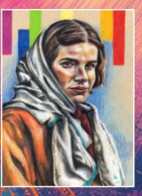

## Portraits to remember. Stories to keep alive.

Pink Triangle Portraits is a portrait series by artist and art teacher Bry Sharland honoring queer people persecuted by the Nazi regime. Each portrait is paired with a researched biography.

## The artistic approach

The project uses expressive color and individual stories to restore attention and dignity to people whose lives were marginalized or erased.

This is starter copy. Replace or expand these sections through Pages CMS.
